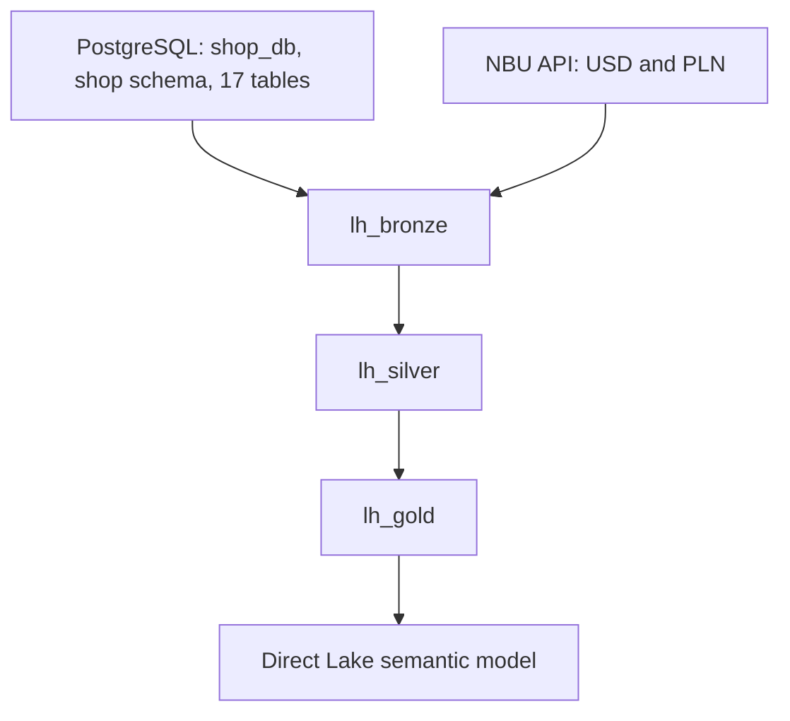
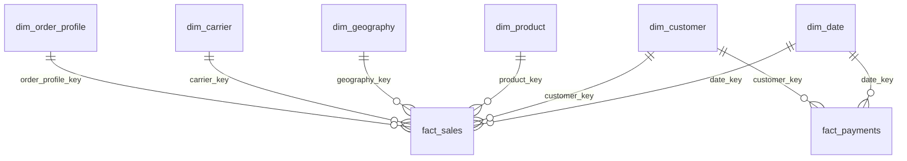

# Store Analytics Platform in Microsoft Fabric

## 1. Architecture

The project aims to integrate store data from Ukraine and Poland to analyze sales in a single currency (USD).



All components are designed to reside in a single Fabric workspace. The main pipeline `pl_main` sequentially invokes `pl_bronze`, `pl_silver`, and `pl_gold` after each preceding stage completes successfully.

## 2. Control Table

The `lh_bronze.etl_control` table defines PostgreSQL ingestion parameters. Each row represents one source table.

| Column | Type | Purpose |
|---|---|---|
| source_schema | STRING | Source schema |
| source_table | STRING | Source table name |
| target_table | STRING | Bronze table name |
| load_type | STRING | Load type: full or incremental |
| watermark_column | STRING | Watermark column |
| last_watermark | STRING | Last loaded watermark value |
| is_active | BOOLEAN | Whether the table is active |
| last_loaded_at | TIMESTAMP | Time of the last successful load |
| last_rows | BIGINT | Number of loaded rows |

The Bronze pipeline uses Lookup to retrieve active records, ForEach to iterate over them, and Copy data to copy tables. Source and destination parameters are assigned dynamically. The control table is updated after successful copying. Adding or disabling a source does not require pipeline changes.

## 3. Data Layers

### Bronze — `lh_bronze`

Raw copies of all 17 ShopDB tables and historical NBU exchange rates for USD and PLN covering the order period. Data is stored without business transformations, with technical columns identifying the source and load time. Full loads replace the raw snapshot, while incremental loads append new and modified records.

### Silver — `lh_silver`

One cleaned Delta table per entity. Type casting, value standardization, and deduplication by business keys are performed before merging. Delta MERGE inserts new records and updates modified ones. NBU exchange rates are consolidated into a table containing the date, currency code, and exchange rate in UAH per currency unit, keyed by date and currency.

### Gold — `lh_gold`

Analytical dimensions and facts organized into a star schema. Dimensions have stable surrogate keys referenced by facts. Updates are designed to use MERGE. Monetary amounts are stored in both the original currency and USD.

Conversion formula using the transaction-date exchange rate:

```text
amount_usd = amount_local × currency_to_uah_rate / usd_to_uah_rate
```

For UAH, the rate to UAH is 1; for PLN, the corresponding NBU exchange rate is used. Records without the required valid exchange rate must not enter Gold without validation.

## 4. Star Schema



| Table | Grain | Main contents |
|---|---|---|
| fact_sales | Order line item | Dimension keys, order number, status, quantity, local currency and USD amounts |
| fact_payments | Payment or refund | Date and customer keys, order number, payment type, method and status, local currency and USD amounts |
| dim_date | Calendar day | Year, quarter, month, day of week, weekend indicator |
| dim_customer | Customer | Country, registration date, age group |
| dim_product | Product | Name, brand, category, parent category |
| dim_geography | City | City, region, country, currency |
| dim_carrier | Carrier | Carrier name |
| dim_order_profile | Combination of order attributes | Payment method, number of installments, delivery type |

## 5. Semantic Model

A Direct Lake model is planned on the Gold tables, with one-to-many (1:*) relationships and single-direction filtering from dimensions to facts.

| Measure | DAX |
|---|---|
| Revenue USD | `SUM(fact_sales[amount_usd])` |
| Orders | `DISTINCTCOUNT(fact_sales[order_id])` |
| Average Order USD | `DIVIDE([Revenue USD], [Orders])` |
| Units Sold | `SUM(fact_sales[quantity])` |
| Cancelled Orders | `CALCULATE(DISTINCTCOUNT(fact_sales[order_id]), fact_sales[order_status] = "cancelled")` |
| Cancellation Rate | `DIVIDE([Cancelled Orders], [Orders])` |
| Payments USD | `SUM(fact_payments[amount_usd])` |

The model is intended to analyze sales trends by month and country, product categories and brands, and payment and delivery methods. These are baseline measures: the rules for including cancelled orders in revenue and units sold, as well as the sign convention for refunds, must be aligned with the actual data.

## 6. Design Decisions

- The Medallion architecture separates raw, cleaned, and analytical data.
- Metadata drives Bronze ingestion without changes to pipeline logic.
- Delta MERGE in Silver and Gold provides the foundation for idempotent updates using stable keys.
- Monetary calculations use decimal data types and historical NBU exchange rates on the transaction date.
- Separate sales and payment facts preserve different grains and prevent row multiplication when directly joining them.
- Orchestration includes a daily schedule, success dependencies, retries for network operations, and error logging.
- Passwords are stored only in Fabric connections, not in the repository.

**Implementation status:** This document describes the proposed architecture based on the existing scaffold. The actual names and keys of the 17 ShopDB tables have not yet been confirmed; Fabric deployment, pipeline execution, idempotency, and the Direct Lake model have not been verified.
