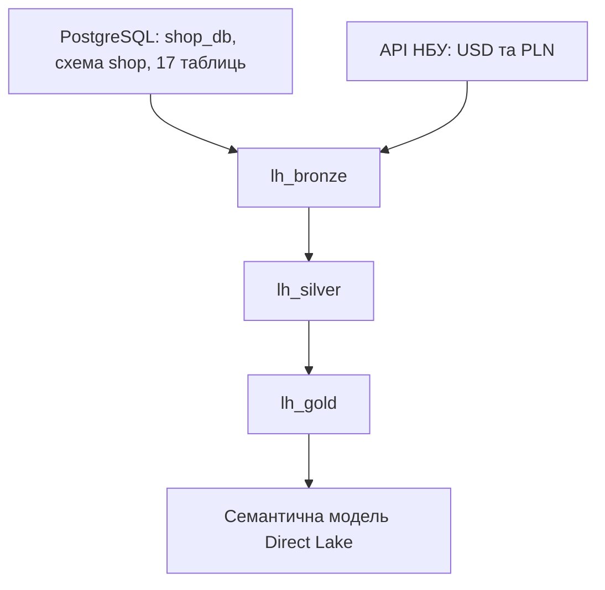
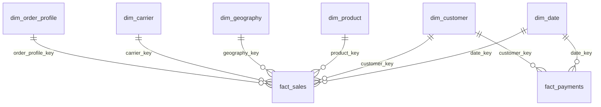

# Аналітична платформа магазину в Microsoft Fabric

## 1. Архітектура

Мета проєкту — об'єднати дані магазину в Україні та Польщі для аналітики продажів у єдиній валюті (USD).



Усі компоненти передбачено розмістити в одному робочому просторі Fabric. Головний конвеєр `pl_main` послідовно запускає `pl_bronze`, `pl_silver` та `pl_gold` після успішного завершення попереднього етапу.

## 2. Таблиця керування

Таблиця `lh_bronze.etl_control` визначає параметри завантаження з PostgreSQL. Кожен рядок відповідає одній таблиці джерела.

| Колонка | Тип | Призначення |
|---|---|---|
| source_schema | STRING | Схема джерела |
| source_table | STRING | Назва вихідної таблиці |
| target_table | STRING | Назва таблиці Bronze |
| load_type | STRING | Тип завантаження: full або incremental |
| watermark_column | STRING | Колонка водяного знака |
| last_watermark | STRING | Останнє завантажене значення водяного знака |
| is_active | BOOLEAN | Ознака активності таблиці |
| last_loaded_at | TIMESTAMP | Час останнього успішного завантаження |
| last_rows | BIGINT | Кількість завантажених рядків |

Конвеєр Bronze використовує Lookup для отримання активних записів, ForEach для їх обходу та Copy data для копіювання таблиць. Параметри джерела і призначення задаються динамічно. Стан таблиці керування оновлюється після успішного копіювання. Додавання або вимкнення джерела не потребує зміни конвеєра.

## 3. Шари даних

### Bronze — `lh_bronze`

Сирі копії 17 таблиць ShopDB та історичні курси НБУ для USD і PLN за період замовлень. Дані зберігаються без бізнес-перетворень, із технічними колонками джерела та часу завантаження. Повне завантаження замінює сирий знімок, інкрементальне додає нові та змінені записи.

### Silver — `lh_silver`

Одна очищена Delta-таблиця на сутність. Перед злиттям виконуються приведення типів, стандартизація значень та видалення дублікатів за бізнес-ключами. Delta MERGE додає нові записи й оновлює змінені. Курси НБУ об'єднуються в таблицю з датою, кодом валюти та курсом у гривнях за одиницю валюти; ключ — дата і валюта.

### Gold — `lh_gold`

Аналітичні виміри та факти у схемі «зірка». Виміри мають стабільні сурогатні ключі, факти посилаються на них. Оновлення передбачено через MERGE. Грошові суми зберігаються у вихідній валюті та USD.

Формула конвертації на дату операції:

```text
amount_usd = amount_local × currency_to_uah_rate / usd_to_uah_rate
```

Для UAH курс до гривні дорівнює 1; для PLN використовується відповідний курс НБУ. Записи без необхідного коректного курсу не повинні потрапляти до Gold без перевірки.

## 4. Схема «зірка»



| Таблиця | Гранулярність | Основний вміст |
|---|---|---|
| fact_sales | Позиція замовлення | Ключі вимірів, номер замовлення, статус, кількість, суми у локальній валюті та USD |
| fact_payments | Платіж або повернення | Ключі дати й покупця, номер замовлення, вид, спосіб і статус платежу, суми у локальній валюті та USD |
| dim_date | Календарний день | Рік, квартал, місяць, день тижня, вихідний |
| dim_customer | Покупець | Країна, дата реєстрації, вікова група |
| dim_product | Товар | Назва, бренд, категорія, батьківська категорія |
| dim_geography | Місто | Місто, регіон, країна, валюта |
| dim_carrier | Перевізник | Назва перевізника |
| dim_order_profile | Комбінація ознак замовлення | Спосіб оплати, кількість платежів розстрочки, тип доставки |

## 5. Семантична модель

Передбачено модель Direct Lake на таблицях Gold зі зв'язками 1:* та односпрямованою фільтрацією від вимірів до фактів.

| Міра | DAX |
|---|---|
| Revenue USD | `SUM(fact_sales[amount_usd])` |
| Orders | `DISTINCTCOUNT(fact_sales[order_id])` |
| Average Order USD | `DIVIDE([Revenue USD], [Orders])` |
| Units Sold | `SUM(fact_sales[quantity])` |
| Cancelled Orders | `CALCULATE(DISTINCTCOUNT(fact_sales[order_id]), fact_sales[order_status] = "cancelled")` |
| Cancellation Rate | `DIVIDE([Cancelled Orders], [Orders])` |
| Payments USD | `SUM(fact_payments[amount_usd])` |

Модель призначена для аналізу динаміки продажів за місяцями та країнами, категорій і брендів, способів оплати й доставки. Наведені міри є базовими: правила включення скасованих замовлень до виручки та проданих одиниць, а також знак повернень необхідно узгодити з фактичними даними.

## 6. Прийняті рішення

- Архітектура Medallion розділяє сирі, очищені та аналітичні дані.
- Метадані керують завантаженням Bronze без зміни логіки конвеєра.
- Delta MERGE у Silver та Gold забезпечує основу для ідемпотентного оновлення за стабільними ключами.
- Грошові розрахунки використовують десяткові типи та історичні курси НБУ на дату операції.
- Окремі факти продажів і платежів зберігають різну гранулярність та запобігають множенню рядків при їх прямому з'єднанні.
- Оркестрація передбачає щоденний розклад, залежності успішного виконання, повтори мережевих операцій та журналювання помилок.
- Паролі зберігаються лише у підключеннях Fabric, а не в репозиторії.

